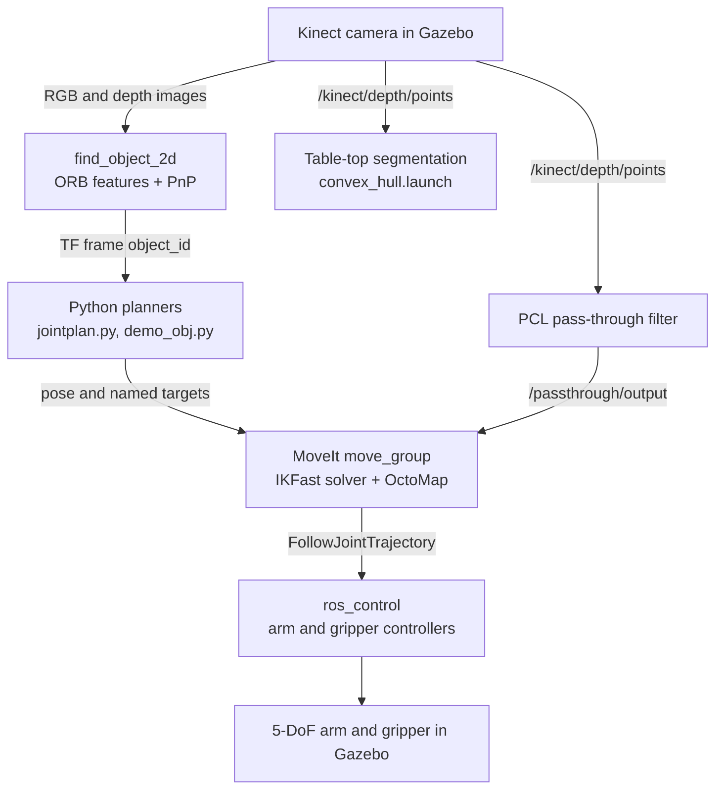

<h1 align="center">Robot Manipulator</h1>

<p align="center"><strong>A 5-DoF arm that finds, tracks and grasps objects in Gazebo.</strong></p>

<p align="center">A ROS Melodic and Gazebo simulation of a 5-DoF robot arm that detects objects with an RGB-D camera,<br>estimates their 6-DoF pose and grasps them with MoveIt.</p>

<p align="center"><a href="#build">Build</a>&nbsp;&nbsp;&nbsp;&nbsp;<a href="#usage">Usage</a>&nbsp;&nbsp;&nbsp;&nbsp;<a href="#system-overview">System overview</a>&nbsp;&nbsp;&nbsp;&nbsp;<a href="#extending-it">Extending it</a>&nbsp;&nbsp;&nbsp;&nbsp;<a href="#license">License</a></p>

<br />

> Detection and grasping are separate ROS nodes joined only by TF. find_object_2d publishes each object's pose as a TF frame, and the planners take only that frame from perception, so another detector can replace it without changes to the grasp code.

<br />

<p align="center">
  
</p>

## Features
- **Object detection and 6-DoF pose.** find_object_2d matches ORB features of trained objects in the camera image. With the depth image and PnP, it publishes each object's 6-DoF pose as a TF frame.
- **Table-top segmentation.** A PCL nodelet pipeline downsamples the point cloud, estimates normals and segments the table plane. It then extracts the objects above the table with a convex hull and a polygonal prism.
- **Obstacle-aware planning.** MoveIt plans with an IKFast solver for the 5-DoF arm. A pass-through filter feeds the depth cloud into an OctoMap, so plans avoid obstacles the camera sees.
- **Grasping.** Python planners read the object's TF frame and drive the arm through the grasp. The arm moves above the object, orients and opens the gripper, descends, grasps and lifts.
- **Dynamic grasping.** When the tracked object is more than 10 cm from the gripper along x or y, the arm plans a new approach and follows it.

## System overview



| Interface | Name | Used by |
|---|---|---|
| RGB image | `/kinect/rgb/image_raw` | find_object_2d |
| Depth image | `/kinect/depth/image_raw` | find_object_2d, for PnP |
| Point cloud | `/kinect/depth/points` | pass-through filter, table-top segmentation |
| Filtered cloud | `/passthrough/output` | MoveIt OctoMap |
| Object pose | TF frame `object_<id>`, for example `object_27` | planners |
| Arm controller | `/robot/arm_controller` (5 joints) | MoveIt |
| Gripper controller | `/robot/gripper_controller` (2 fingers) | MoveIt |
| Planning groups | `arm` (idle, pose1, goal) and `gripper` (open, close) | planners |

## Requirements
Last tested in 2020 with:
- Ubuntu 18.04 and ROS Melodic (desktop-full, which includes Gazebo 9)
- MoveIt 1, ros_control, find_object_2d and pcl_ros, which rosdep installs from the package manifests
- gazebo_grasp_plugin, built from source with the repositories below

## Build

```bash
mkdir -p ~/catkin_ws/src && cd ~/catkin_ws/src
git clone https://github.com/AdilShaikh1/Robot_manipulator
git clone https://github.com/JenniferBuehler/gazebo-pkgs            # gazebo_grasp_plugin
git clone https://github.com/JenniferBuehler/general-message-pkgs    # messages that gazebo-pkgs needs
cd ~/catkin_ws && rosdep install --from-paths src --ignore-src -y
catkin_make && source devel/setup.bash
```

## Usage
**Detect an object and grasp it:**

```bash
roslaunch five_dof_manipulator arm6d.launch     # Gazebo world, arm, controllers, object detection
roslaunch five_dof_manipulator moveit6d.launch  # MoveIt, RViz and the OctoMap
rosrun five_dof_manipulator jointplan.py        # find object_27 and grasp it
```

**Dynamic grasping:** run `demo6d.launch` instead of `arm6d.launch`, then run `rosrun five_dof_manipulator demo_obj.py` and drag the can in Gazebo.

**Table-top segmentation:** with the simulation running, `roslaunch five_dof_manipulator convex_hull.launch` starts the PCL pipeline and opens it in RViz.

## Demo
The robot detects a trained object, estimates its pose and grasps it. If the object is moved on the table, the arm follows it.

<p align="center">
  
  
</p>
<p align="center"><em>Object detection with ORB features (left) and pose estimation from the depth camera's point cloud (right).</em></p>

<p align="center">
  
  
</p>
<p align="center"><em>The arm at the pick table (left) and between the two tables of the Gazebo world (right).</em></p>

## Extending it
- **Detect your own objects.** The detector loads its trained objects from a saved find_object_2d session: `five_dof_manipulator/session/block.bin`, or `five_dof_manipulator/demo/session/demo.bin` for the dynamic demo. Add objects in the find_object_2d window and save the session over that file.
- **Grasp a different object.** Detected objects appear as TF frames named `object_<id>`. Both planners pick `object_27`, so change `obj = "object_27"` in `five_dof_manipulator/trajectory/jointplan.py` or `five_dof_manipulator/demo/demo_obj.py`.
- **Change what the OctoMap sees.** `five_dof_manipulator/launch/filter.launch` drops the points whose y coordinate lies between -0.12&nbsp;m and 0.184&nbsp;m before they reach MoveIt's OctoMap. Adjust those limits for your scene.
- **Change the arm.** After editing the URDF, regenerate the IKFast solver and run `robot_arm_ikfast_plugin/update_ikfast_plugin.sh` to rebuild the MoveIt plugin around it.

## Repository layout
- `five_dof_manipulator/`: robot description and meshes, Gazebo worlds, controllers, perception launch files, planners and demos
- `robot_moveit_config/`: MoveIt configuration (OMPL and CHOMP pipelines)
- `robot_arm_ikfast_plugin/`: IKFast kinematics plugin for the arm
- `pictures/`: screenshots
- `CHANGELOG.md`: release history

## Limitations
- It targets ROS Melodic, which reached end of life in May 2023.
- `jointplan.py` grasps and lifts one object. It doesn't place it.
- Detection works only for objects in the saved find_object_2d sessions.

## License
The five_dof_manipulator package and the pictures are MIT licensed (see LICENSE). Generated IKFast solver code keeps its original license header.
