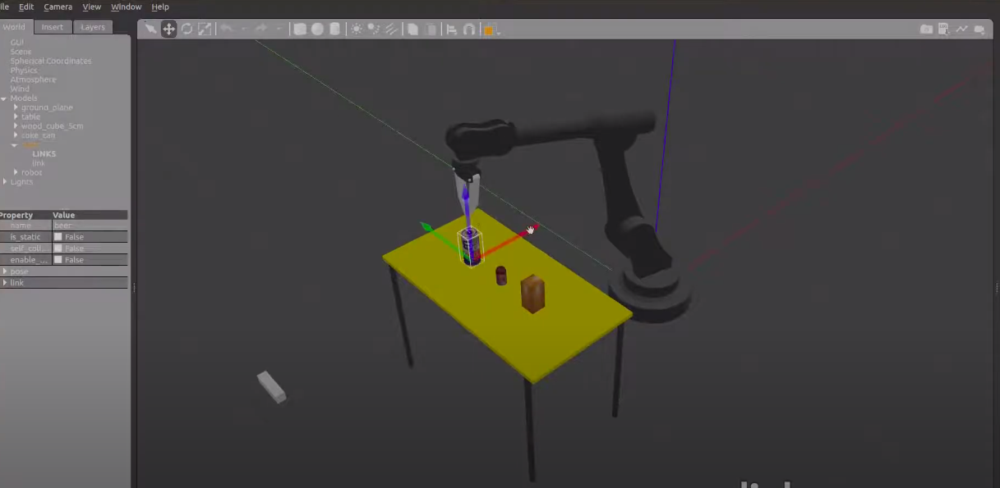
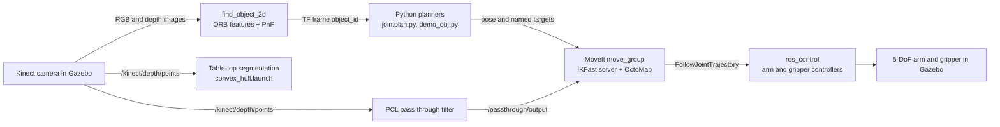
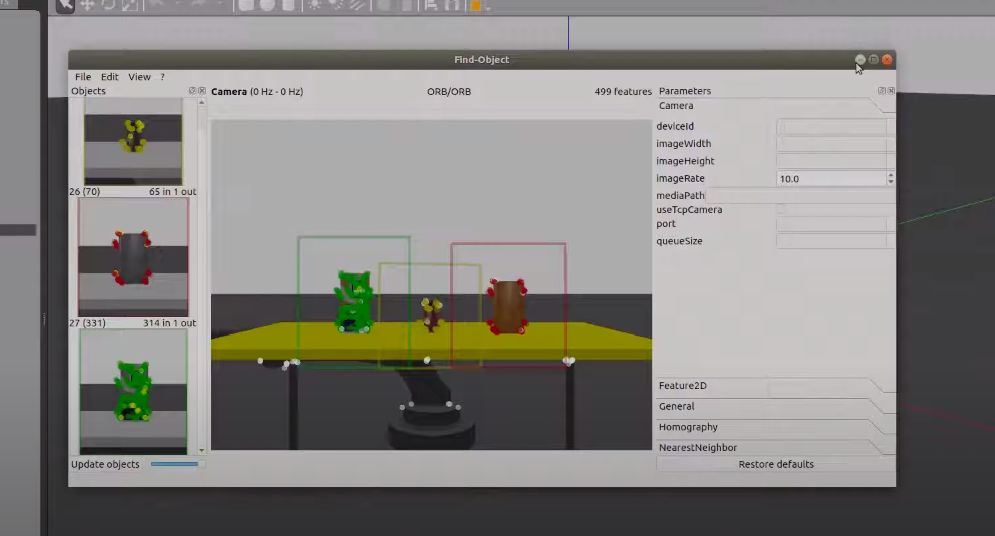
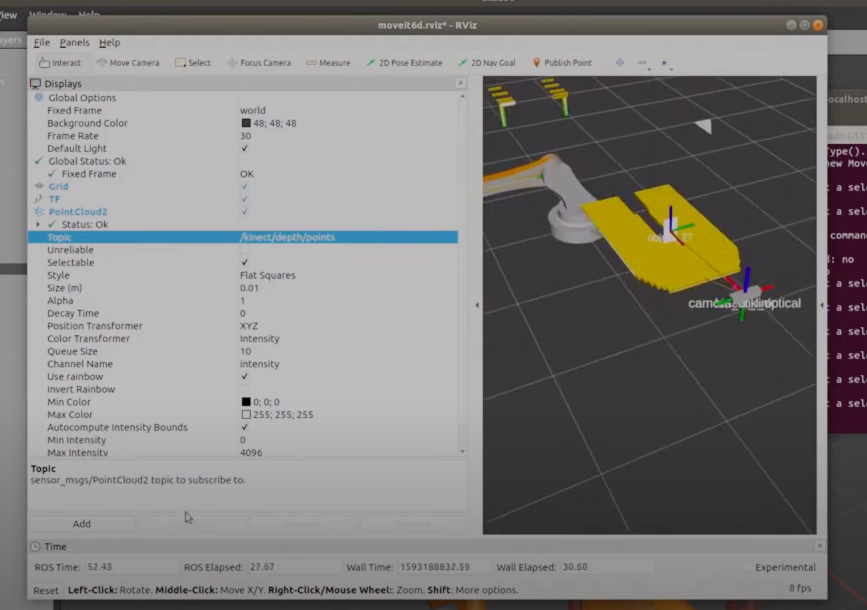
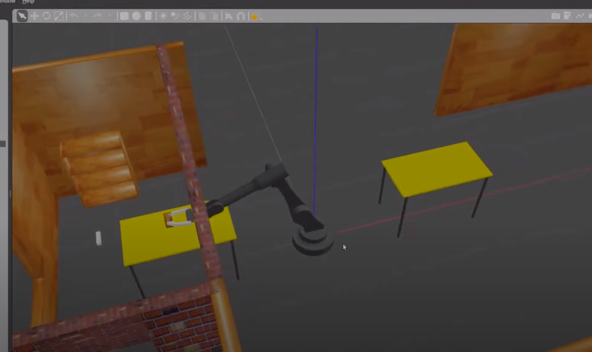
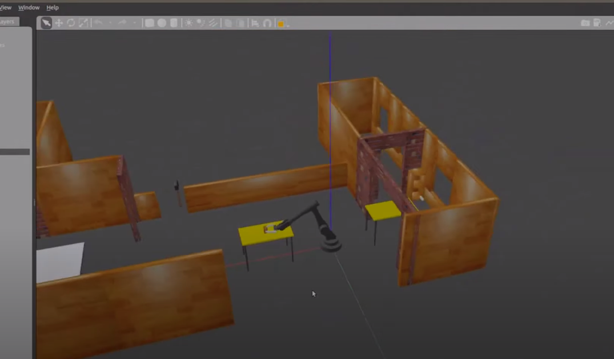

# Robot_manipulator

Robot_manipulator is a 5-DoF robot arm in ROS Melodic and Gazebo. It finds an object with an RGB-D camera, estimates the object's 6-DoF pose and picks it up. I developed it as a personal project in 2020.



## What I did
- **Object detection and 6-DoF pose.** find_object_2d matches ORB features of trained objects in the camera image. With the depth image and PnP, it publishes each object's 6-DoF pose as a TF frame.
- **Table-top segmentation.** A PCL nodelet pipeline downsamples the point cloud, estimates normals and segments the table plane. It then extracts the objects above the table with a convex hull and a polygonal prism.
- **Obstacle-aware planning.** MoveIt plans with an IKFast solver for the 5-DoF arm. A pass-through filter feeds the depth cloud into an OctoMap, so plans avoid obstacles the camera sees.
- **Grasping.** Python planners read the object's TF frame and drive the arm through the grasp. The arm moves above the object, orients and opens the gripper, descends, grasps and lifts.
- **Dynamic grasping.** When the tracked object is more than 10 cm from the gripper along x or y, the arm plans a new approach and follows it.

## System overview



| Interface | Name | Used by |
|---|---|---|
| RGB image | `/kinect/rgb/image_raw` | find_object_2d |
| Depth image | `/kinect/depth/image_raw` | find_object_2d, for PnP |
| Point cloud | `/kinect/depth/points` | pass-through filter, table-top segmentation |
| Filtered cloud | `/passthrough/output` | MoveIt OctoMap |
| Object pose | TF frame `object_<id>`, for example `object_27` | planners |
| Arm controller | `/robot/arm_controller` (5 joints) | MoveIt |
| Gripper controller | `/robot/gripper_controller` (2 fingers) | MoveIt |
| Planning groups | `arm` (idle, pose1, goal) and `gripper` (open, close) | planners |

## Results
In Gazebo the robot detects a trained object, estimates its pose and grasps it. If the object is moved on the table, the arm follows it.

## 1. Prerequisites
I built and ran it in 2020 with:
- Ubuntu 18.04 and ROS Melodic (desktop-full, which includes Gazebo 9)
- MoveIt 1, ros_control, find_object_2d and pcl_ros, which rosdep installs from the package manifests
- gazebo_grasp_plugin, built from source with the repositories below

## 2. Build

```bash
mkdir -p ~/catkin_ws/src && cd ~/catkin_ws/src
git clone https://github.com/AdilShaikh1/Robot_manipulator
git clone https://github.com/JenniferBuehler/gazebo-pkgs            # gazebo_grasp_plugin
git clone https://github.com/JenniferBuehler/general-message-pkgs    # messages that gazebo-pkgs needs
cd ~/catkin_ws && rosdep install --from-paths src --ignore-src -y
catkin_make && source devel/setup.bash
```

## 3. Run
**Detect an object and grasp it:**

```bash
roslaunch five_dof_manipulator arm6d.launch     # Gazebo world, arm, controllers, object detection
roslaunch five_dof_manipulator moveit6d.launch  # MoveIt, RViz and the OctoMap
rosrun five_dof_manipulator jointplan.py        # find object_27 and grasp it
```

**Dynamic grasping:** run `demo6d.launch` instead of `arm6d.launch`, then run `rosrun five_dof_manipulator demo_obj.py` and drag the can in Gazebo.

**Table-top segmentation:** with the simulation running, `roslaunch five_dof_manipulator convex_hull.launch` starts the PCL pipeline and opens it in RViz.

## Repository layout
- `five_dof_manipulator/`: robot description and meshes, Gazebo worlds, controllers, perception launch files, planners and demos
- `robot_moveit_config/`: MoveIt configuration (OMPL and CHOMP pipelines)
- `robot_arm_ikfast_plugin/`: IKFast kinematics plugin for the arm
- `pictures/`: screenshots

## Limitations
- It targets ROS Melodic, which reached end of life in May 2023. I haven't rerun these steps since 2020.
- `jointplan.py` grasps and lifts one object, `object_27`. It doesn't place it.
- Detection works only for the objects trained in `objects/` and the saved find_object sessions.

## Media








## License
The five_dof_manipulator package and the pictures are MIT licensed (see LICENSE). Generated IKFast solver code keeps its original license header.
